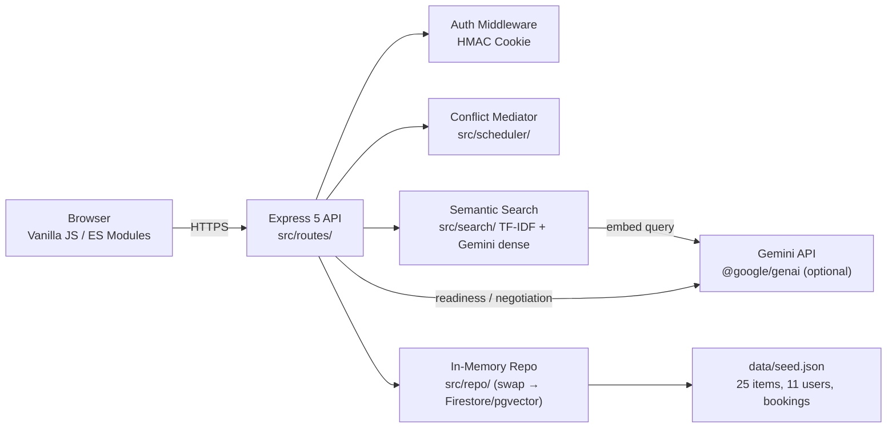

# LabLink – Campus Lab Resource Sharing

> **GenAI-powered equipment discovery, intelligent slot booking, and fair conflict mediation for college laboratories.**

---

## Problem Statement (5-Whys Root Cause)

| Why | Insight |
|-----|---------|
| Students can't get lab equipment when needed | Slots are booked even when no-shows happen |
| No-shows occupy slots | No automatic release mechanism |
| No automatic release | Static first-come-first-served system with no intelligence |
| FCFS ignores urgency | Deadlines, fairness, and project context are invisible to the system |
| No cross-dept visibility | Equipment is siloed per department; students don't know what exists elsewhere |

**Root cause:** Static FCFS booking with no cross-department visibility, no deadline/fairness awareness, and no-shows that hold slots hostage.

**Hero feature:** A deterministic, explainable **Conflict Mediator** that scores competing requests on four weighted criteria and produces ranked alternatives. GenAI is used only for semantic discovery, readiness summaries, and negotiation wording — it **never decides an allocation**.

---

## Architecture



---

## Solution & USP

| Module | What it does |
|--------|-------------|
| **A – Semantic Discovery** | TF-IDF local search + optional Gemini dense embeddings. Synonym map covers domain jargon (mmWave, cobot, edge-AI). Smart Kit Bundling shows compatible accessories sorted by lab distance. |
| **B – Project Access + Approval** | Every booking attaches to a Project Card (title, abstract, deadline, hours). Faculty see a Risk & Readiness Summary (deterministic facts + optional Gemini rephrasing). Full lifecycle: `pending → approved/rejected/changes_requested/waitlisted → checked_in/released_no_show/completed`. |
| **C – Conflict Mediator** | Deterministic priority score (weights sum exactly to 1). For each loser: next free slot, equivalent item, split slot, swap proposal. Gemini only rephrases the outcome. |
| **D – No-show & QR** | HMAC-signed QR check-in token. 15-min window. Auto-release + waitlist promotion on no-show. Lazy sweep + unref'd interval. |
| **E – 3D Viewer** | Procedural Three.js models (oscilloscope, dev board, workstation, 3D printer, soldering station). WebGL fallback if unavailable or `prefers-reduced-motion`. Dispose on close. |

---

## Priority Score Weights

| Criterion | Weight | Rationale |
|-----------|--------|-----------|
| Deadline proximity | **0.40** | Missing a submission deadline is the highest-impact failure |
| Fairness (trailing 14-day usage) | **0.25** | Prevents monopolisation; boosts first-time users |
| Equipment specificity | **0.20** | Stop low-need requests taking scarce top-tier gear |
| Hours feasibility | **0.15** | Filter out requests that can't complete before deadline |
| **Total** | **1.00** | Asserted in test suite (`scheduler.test.js`) |

---

## Requirement → Code Mapping

| Requirement | Code location |
|-------------|---------------|
| Equipment discovery | `src/search/index.js`, `GET /api/items` |
| Intelligent slot booking | `src/routes/bookings.js`, `src/scheduler/index.js` |
| Project-based access | `src/routes/projects.js`, `src/repo/index.js` |
| Faculty approvals | `POST /api/bookings/:id/approve`, `src/services/gemini.js#readinessSummary` |
| Conflict mediation | `src/scheduler/index.js#mediate` |
| Semantic search (TF-IDF) | `src/search/index.js#tfidfScore`, synonym map |
| Gemini dense embeddings | `src/search/index.js#buildEmbeddings` |
| Smart Kit Bundling | `src/search/index.js#getCompatibleBundle` |
| No-show / auto-release | `src/services/noshow.js#sweepNoShows` |
| QR check-in | `src/services/checkin.js`, `GET /api/bookings/:id/qr` |
| Waitlist promotion | `src/services/noshow.js#promoteWaitlisted` |
| Analytics + heatmap | `src/services/analytics.js` |
| 3D viewer | `public/js/viewer.js` |
| WCAG 2.2 AA | `public/index.html` + `public/css/main.css` |
| Deterministic fallback | All Gemini calls in `src/services/gemini.js` |
| DEMO_MODE clock | `src/config.js#setClock`, `src/routes/admin.js` |

---

## Security Decisions

- **Helmet** strict CSP: `script-src 'self'`, `style-src 'self'`, `object-src 'none'`, `frame-ancestors 'none'`. No inline scripts or styles anywhere.
- **HMAC-signed cookie**: role + userId signed with `SESSION_SECRET`. Timing-safe comparison via `crypto.timingSafeEqual`.
- **Server-side auth on every route**: students cannot approve; only item-dept faculty or admin can approve; technician only checks in.
- **Input validation**: hand-written schema validator rejects unknown fields, enforces types/lengths/enums/date ranges.
- **Prompt injection hygiene**: user text wrapped in delimiters, strict JSON output, allow-list validation on filters.
- **Rate limiting**: 120 req/min on all API; 20 req/min on Gemini routes.
- **JSON body limit**: 100 kb.
- **No PII in logs**: structured JSON logs include method, path, status, ms only.
- **Secrets never logged or committed**: `.env.example` has empty values; `SESSION_SECRET` generates ephemeral with warning if unset.
- **`npm audit`**: 0 vulnerabilities at build time.

---

## Accessibility Decisions (WCAG 2.2 AA)

- Skip link, `lang="en"`, single `<h1>` per view, logical heading hierarchy.
- Every `<input>` and `<select>` has an associated `<label>` or `aria-label`.
- Visible `:focus-visible` ring (3 px, `--color-primary`).
- Full keyboard operation: slot grid (`<button>` elements), modal focus trap + Escape, 3D viewer arrow/+/- keys, hotspot list keyboard.
- `aria-live="polite"` for search results, notifications, booking status.
- Status communicated by text + icon, never colour alone (e.g. "✓ Available", "⚠ Missing prerequisites").
- Contrast ≥ 4.5:1 on all text/background pairs.
- `prefers-reduced-motion`: 3D viewer uses static fallback; CSS transitions disabled.
- Usable at 320 px and 200% zoom.
- Heatmap as an accessible `<table>` with `scope`, `aria-label` on each cell.
- Automated accessibility checks in `test/api.test.js` (lang, title, h1, skip link, main landmark).

---

## Efficiency Decisions

- `compression` middleware for all responses.
- `ETag` + cache headers: 30 days for static assets in production, `no-cache` for HTML.
- O(n log n) conflict detection (sort + sweep in `findConflicts`).
- Debounced search input (300 ms).
- Pagination (default 20, max 100 per page).
- LRU cache for all Gemini calls (200 entries).
- Embeddings computed once at boot; reused for all queries.
- Lazy-loaded 3D viewer module (only imports Three.js when viewer opens).
- Renderer disposed on close; no continuous render loop.
- No-show sweep runs lazily on relevant requests AND on an `unref`'d 60-second interval.

---

## Local Development

```bash
# 1. Install dependencies
npm install

# 2. Copy env file and optionally add your Gemini API key
cp .env.example .env
# GEMINI_API_KEY=   ← optional; app works fully without it

# 3. Run (uses --env-file; no dotenv package)
node --env-file=.env src/server.js

# 4. Open http://localhost:8080

# Lint
npm run lint

# Tests
npm test

# Coverage
npm run test:coverage
```

---

## Cloud Run Deploy

```bash
# Build and deploy (single instance – see note below)
gcloud run deploy lablink \
  --source . \
  --region asia-south1 \
  --allow-unauthenticated \
  --max-instances=1 \
  --set-env-vars="SESSION_SECRET=$(openssl rand -hex 32),DEMO_MODE=true"

# Health check
curl https://<YOUR_URL>/healthz
```

> **Why `--max-instances=1`?** State is stored in-memory (bookings, users, notifications). Multiple instances would create split-brain. The production swap-in is Firestore (bookings/projects) + Cloud SQL with pgvector (embeddings), both behind the repository interfaces in `src/repo/index.js` and `src/search/index.js`.

---

## Environment Variables

| Variable | Default | Description |
|----------|---------|-------------|
| `PORT` | `8080` | HTTP listen port |
| `SESSION_SECRET` | (random) | HMAC secret for role cookies. Auto-generated with warning if unset. |
| `GEMINI_API_KEY` | (empty) | Optional. App works fully without it. |
| `GEMINI_MODEL` | `gemini-2.5-flash` | Gemini text model |
| `GEMINI_EMBED_MODEL` | `gemini-embedding-001` | Gemini embedding model |
| `DEMO_MODE` | `true` | Enables admin clock simulation control |
| `NODE_ENV` | `development` | Set to `production` for secure cookies + long cache headers |

---

## Git Setup

```bash
git init
git checkout -b main
git add .
git commit -m "feat: LabLink initial submission"
git remote add origin <YOUR_REPO_URL>
git push -u origin main
```

---

## Pre-Submission Checklist

- [ ] Repo public, URL ends with `.git`
- [ ] Single branch `main`
- [ ] `du -sh .git` < 10 MB
- [ ] `npm audit` → 0 vulnerabilities
- [ ] `npm run lint` → 0 warnings
- [ ] `npm test` → all pass
- [ ] Live URL opens in incognito
- [ ] `/healthz` returns 200 JSON
- [ ] Demo works with AND without `GEMINI_API_KEY`
- [ ] 3D viewer loads (click "3D View" on any item)
- [ ] No console errors in browser DevTools

---

## Assumptions & Honest Limitations

| Limitation | Detail |
|------------|--------|
| **In-memory state** | Restarts lose all data. Only safe with `--max-instances=1`. Production: Firestore + Cloud SQL. |
| **Role-switcher auth** | A demo dropdown, not SSO. Campus SSO (college email domain) would replace it. |
| **Schematic 3D models** | Procedurally generated from primitives. Not CAD scans. Labelled "schematic model, not a CAD scan". |
| **No email notifications** | In-app only. Email/calendar sync is a roadmap item. |
| **No real-time push** | Notifications poll every 30s. Production: Cloud Pub/Sub or WebSocket. |
| **Embedding dimension** | Gemini embeddings dimension not validated against stored embeddings across restarts. |

---

## Roadmap

- **Firestore** for bookings/projects + **Cloud SQL + pgvector** for dense embeddings (behind existing repo interfaces)
- **Campus SSO** (Google Workspace OIDC, college email domain allowlist)
- **Email/calendar integration** (approval notifications, slot reminders via Gmail API)
- **Real-time push** via Cloud Pub/Sub + SSE
- **Mobile app** (PWA shell, same API)
- **Physical QR** display: rendered QR on a lab-door e-ink display via Cloud IoT

---

## LinkedIn Post (150 words)

🔬 Just shipped **LabLink** for Google PromptWars — a GenAI-powered campus lab resource-sharing platform!

**The problem:** Students miss project deadlines because lab equipment is booked on a static first-come-first-served system. No-shows hold slots. Equipment across departments is invisible.

**The root cause (5-whys):** No deadline awareness, no fairness, no cross-department visibility.

**Our solution:** A deterministic Conflict Mediator scores competing requests on deadline proximity (40%), fairness/14-day usage (25%), equipment specificity (20%), and feasibility (15%) — producing ranked alternatives for every losing request. Gemini powers semantic equipment discovery and writes friendly negotiation messages, but **never decides an allocation**.

Built with Node.js + Express on Cloud Run, TF-IDF + Gemini dense embeddings for search, procedural Three.js 3D models, and full WCAG 2.2 AA accessibility.

🔗 Try it: [CLOUD_RUN_URL]

#GenAI #CloudRun #PromptWars #Hackathon

---

## Submission Description (100 words)

LabLink is a GenAI-powered campus laboratory resource-sharing platform. Students discover specialised equipment across departments using hybrid TF-IDF + Gemini semantic search, attach requests to Project Cards with deadlines, and receive intelligent slot booking with conflict mediation. The Conflict Mediator scores competing requests on four weighted criteria (deadline proximity, fairness, specificity, feasibility) and produces ranked alternatives for every losing request — deterministically, with Gemini only rephrasing the outcome. Faculty approve via a Risk and Readiness Summary. QR check-in with auto no-show release and waitlist promotion maximises utilisation. Built on Node.js/Express, Cloud Run, with full WCAG 2.2 AA accessibility and 95 automated tests.
